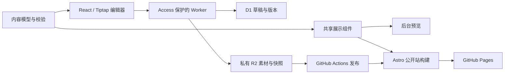

# 网站重构全面审计 · 2026-10-24

> 本文是修复前的历史基线。后续修复、复测证据与剩余上线事项见 [修复与接入准备报告](remediation-2026-10-24.md)，以下原始发现保留不改写。

## 结论

**模块化重构的主体已经成立，但当前版本尚未达到最终设计目标的完整验收标准，也不具备直接切换生产的条件。** 核心方向不需要推倒重选；接下来应修复已经证实的缺陷、补足质量门禁，并验证真实部署链路。

本轮确认 **6 项待修复问题**：长中文图片名导致素材库崩溃、损坏图片被接受、删除 Blog 后文章失去管理入口、富文本编辑丢失标题锚点、文字对比度不足、中文申请卡的语言与朗读参数错误。详细复现、代码位置和修复验收标准见 [Bug 报告](bugs-2026-10-24.md)。这些问题本轮尚未修复。

| 维度 | 审计判断 |
| --- | --- |
| 语言、框架与模块化 | 基本达到：TypeScript、Astro、React/Tiptap、Worker，内容模型和展示模块共享 |
| 已选外观与布局 | D / A / N1 已实现，几何坐标与响应式测试通过；没有建立完整的批准截图像素回归基线 |
| News 与 Medium | 主要行为已实现并验证，不再依赖 Medium 展示插件 |
| Admin 日常编辑 | 主要流程可用，异常操作与内容完整性仍有缺陷，不能称为全面完成 |
| 无障碍 | 保留了工具和主要行为，但对比度与语言问题未达标，真实辅助技术尚未验收 |
| 性能 | HTML 和 JS 体积较小；Lighthouse 四项全 100 未达到，Research 手机端尤其需要优化 |
| 安全 | 代码已具备多层防护，生产依赖扫描无已知告警；生产 Access、权限与账户配置未实测 |
| 发布、回滚与运维 | 有实现和局部集成测试；没有完成真实发布/回滚/灾难恢复演练 |

## 审计对象与证据边界

对象为本机 `codex/modular-rebuild` 分支的未提交工作区，以及 `127.0.0.1:4323` 的构建预览。**不是对线上旧站的生产认证。** 工作区包含新源码和原站文件的既有删除；本轮没有撤销它们，没有提交、推送或部署。

此次比对了 103 个应用/构建相关源码文件的 SHA-256，审计前后没有变化。新增内容只有审计用例、辅助测量和文档。会写入的浏览器测试运行在 4173 / 8788 与 `.artifacts/e2e-state` 的隔离环境；正常预览没有被测试用例重置、删除页面或上传异常文件。读取 Medium 会按应用既有规则更新 RSS 缓存。

证据分为三类：

- **本地已验证：** 实际执行的构建、测试、浏览器交互和测量。
- **代码已实现：** 能找到相应实现，但不代表真实云端配置或完整生产链路已验证。
- **未验证/未完成：** 缺少必要配置、环境、实机或验收结果，明确保留为待办。

## 对照最终设计目标

| 目标 | 当前实现和证据 | 状态 |
| --- | --- | --- |
| 从底层进行 clean start | 新内容 schema、共享渲染器、独立编辑器与服务层；产物无 Hexo、旧 Firebase 调用或 SociableKit；保留原公开 URL，不是运行旧代码兼容层 | 本地已验证 |
| 统一语言与现代框架 | TypeScript 7.0.2；Astro 7.4.2；React 19.3.1 / Tiptap 3.32.0；Hono 4.13.13 / Zod 4.6.7；pnpm 锁定版本 | 已实现 |
| UI 延续原风格，按最终选择修改标题 | 首页 D、子页 A、导航 N1；英文标题设计、首页辅助中文名；Explore more | 已实现，仍缺完整截图基线 |
| 首页为未来照片预留模块 | 支持无图、移入现有头像、独立上传；当前默认不放首屏照片，测试确认移动头像不重复显示 | 本地已验证 |
| 所有页面共用容器、导航位置一致 | `SiteShell / Header / PageTitle / RenderBlock` 共用；首页与四个主要子页的导航坐标完全一致，A 标题坐标一致 | 本地已验证 |
| 手机 Menu 与桌面导航字体/颜色一致 | 共用 Jost / N1 样式，展开层级和字体测试通过 | 本地已验证 |
| 无障碍工具位置、功能保持 | 固定右下角、偏好保存、Escape 返回焦点、深色/放大/高对比度/朗读均有实现；按钮滚动时位置测试通过 | 部分达标，见 AUD-05/06 |
| News 自动轮播 | 多条且超出容器时滚动；悬停、焦点、手动暂停、页面隐藏、朗读、减少动态效果均有处理 | 本地已验证 |
| 每次访问 Media 自动更新 Medium | 页面进入时调用同源 API；Worker 使用官方 RSS；五分钟上游缓存与原子刷新，失败保留内容 | 本地已验证，生产待验证 |
| Medium 日期、封面、默认图和官方字标 | 本站原生卡片；缺图及错误封面使用自绘 SVG；官方 SVG 字标；链接回 Medium | 本地已验证 |
| 英文 Admin，结构/页面/发布分层 | Site structure、Pages、各页工作区、Review & publish 分离；文章与归档归在 Blog；主体操作文案英文 | 已实现，异常提示和细节仍需完善 |
| 首页头像、News、其他文字可编辑 | Home 下有 Opening / Content / News；头像上传、正文、列表进入 News 详情、多选删除与撤销已有测试 | 正常流程通过，见 AUD-01/02/04 |
| 所有页面内容可视化管理 | 页面/区块、文章、归档、媒体、站点设置均可编辑；删除集合入口存在缺陷，部分文章元信息仍硬编码 | 部分达标，见 AUD-03/04 |
| `/admin/` 使用 Cloudflare Access | 路径和 Worker 验证代码正确；没有使用 `admin.lzzhu.net` | 代码已实现，生产未配置验收 |
| 只管理 www 的指定路径 | Worker 路由仅 `www.lzzhu.net/admin*`、`www.lzzhu.net/api/*`；公开产物 CNAME 为 www | 本地配置已核对，线上规则待验收 |
| 桌面/移动/Apple/Android/Windows 一致体验 | Edge 与 WebKit 测试、390/768/3840 等视口检查通过；不是原生 App，也不需要 Electron 才能实现目标 | 部分验证，缺真实设备/辅助技术 |
| UHD 清晰度 | 矢量 Logo/默认封面；研究图使用 SVG，但内含 6 个位图对象；照片有响应式尺寸；头像源图 1344×1334、卡片图 1520×1519；UVA 标记 200×200、当前显示宽度 50 | 当前使用尺寸有依据，不能把 SVG 容器等同于全部无限清晰 |
| 原生平台增强 | 跨文档 View Transitions、Speculation Rules、减少动态效果、原生 CSS 已使用；受保护/业务路径被排除预渲染 | 已实现，动画跨真实平台体验待验收 |
| 字体自托管、中文子集 | 自托管字体；中文按字形分组、`unicode-range` 按需加载；选中的三个英文字体文件均为静态字重，没有可变轴 | 子集化达到，可变字体未采用 |
| OG 自动生成 | 23 张 OG 图在发布构建阶段用 Satori + resvg 生成 | 功能达到；并非早期提出的 Worker 实时生成 |
| HTML <14KB，公开站低 JS | 首页 9,399 B；公开外部 JS 合计 gzip 4,115 B，无 React 浏览器运行时 | 首页体积达到；不是全站原始 HTML 都 <14KB |
| Lighthouse 四项 100 | 实测仍有性能、对比度及 Media 嵌入相关扣分 | 未达到 |
| 申请卡余额/历史迁移 | 新计数、幂等和管理服务已实现；旧服务本轮只读请求仍 HTTP 500，尚未取得有效迁移数据 | 未完成，不可将初始 0 当作旧余额 |

**News 当前只有一条，因此不滚动不是 bug。** 测试加入足够条目后确认自动滚动，再验证手动暂停及减少动态效果。为了“看起来在动”重复播放一条消息不符合当前实现的行为约定。

**Medium 不需要管理者手动刷新。** “每次访问自动检查”不表示每位访客都向 Medium 发起一次上游请求：浏览器/API 有短缓存，上游 RSS 有五分钟刷新间隔。2026-10-24 20:53（新加坡时间）检查本地 API 返回 200、1 篇文章，最近成功同步时间为 20:48。官方提供了个人主页 RSS，可用于这种内容聚合。[Medium 官方 RSS 文档](https://help.medium.com/hc/en-us/articles/214874118-Using-RSS-feeds-of-profiles-publications-and-topics)

## 架构与可维护性

这是一套实际的职责划分，不只是把旧文件放进不同文件夹。公开站与编辑预览共享展示实现，内容不存任意 HTML，发布从冻结快照生成，素材也有独立存储边界。Astro、React 等是源码依赖，不是需要把内容交给其运营商管理的建站服务；业务代码可自行控制，但托管仍依赖已选定的 Cloudflare 和 GitHub。

进一步改进应针对具体边界，而不是为“高级”增加框架：

1. **分离文章集合与其展示页面。** AUD-03 正是数据关系被 UI 结构隐式决定的结果。
2. **定义富文本往返契约。** 模型、Tiptap 和渲染器支持的属性必须一致，防止 AUD-04 这类静默丢失。
3. **把素材验证设为独立生命周期。** 上传、验证、预览、发布引用应有明确状态，避免成功提示先于可用性判断。
4. **容量增长时按页面存储。** 目前整个站点作为一个 JSON 文档保存，约 78,968 B，应用限制 1,800,000 B；当前规模可用，但每次保存和撤销复制整站，不适合无限增长。未来可替换存储适配层，保留区块和展示接口。
5. **继续分解编辑器内部职责。** Home、Blog、普通页的工作区目前仍集中在较大的 PageEditor 中；可以在不变更 UI 的情况下拆成页面类型工作区。无需另建一套通用 CMS 平台。

`@scope`、container queries、anchor positioning、scroll-driven animations、`light-dark()` 等早期建议没有全部采用。它们不是“架构现代化”的合格证；有明确交互或布局用途再使用，避免为了勾选技术清单改变外观。当前也没有引入 Vue、Electron、Oracle 中间服务或旧站运行时。

## 构建、功能与链接检查

| 检查 | 本轮结果 | 说明 |
| --- | --- | --- |
| TypeScript | 通过 | `pnpm check` |
| 单元测试 | 13 / 13 通过 | 内容边界、认证边界、RSS 等 |
| Edge + WebKit 常规集成测试 | 46 / 46 通过 | 无跳过、无 flaky，约 3.6 分钟 |
| 新增异常操作审计 | 4 / 4 复现缺陷 | 用例以正确行为为断言，当前全部失败；不能并入“全绿” |
| 完整构建 | 通过 | Astro 23 个内容页 + 404；后台构建成功；生成 23 张 OG |
| 公开产物审计 | 通过 | 99 个文件，无检查范围内的私有源码泄漏/缺失引用素材 |
| 已构建站内链接/锚点 | 360 个，0 个失效 | 静态快照；不涵盖将来删页或富文本编辑后的变化 |
| 页面遍历 | 23 个公开页，桌面和手机宽度通过 | 本地图片解码、单一 H1、脚本错误及水平溢出检查 |
| 生产依赖已知漏洞扫描 | 0 条告警 | 本次数据库返回：266 项依赖 + 128 项可选依赖；不是未知漏洞保证 |
| 生产配置预检查 | 按预期阻止部署 | Access 参数尚未填写，未触发真实部署 |

Firefox 本轮没有计入通过；此前本机启动受到系统运行库问题影响，CI 虽配置三种引擎，但该工作区尚未推送运行。WebKit 自动化也不能替代实际 iPhone Safari。

## 性能与资源审计

Lighthouse 13.5.0，Edge 155，无头浏览器，本地已构建页面；手机使用工具的模拟设备和节流，桌面使用 desktop preset。各场景为单次测量。测试浏览器默认禁用返回缓存的参数已从最终复测中移除。

| 页面/设备 | 性能 | 无障碍 | 最佳实践 | SEO | LCP | CLS |
| --- | ---: | ---: | ---: | ---: | ---: | ---: |
| 首页 · 手机 | 93 | 96 | 100 | 100 | 2.6 秒 | 0.001 |
| 首页 · 桌面 | 100 | 96 | 100 | 100 | 0.6 秒 | 0.001 |
| Research · 手机 | 73 | 94 | 100 | 100 | 6.3 秒 | 0.072 |
| Media · 手机 | 87 | 96 | 96 | 100 | 2.8 秒 | <0.001 |

四次测量的总阻塞时间（TBT）均为 0 ms。Media 的最佳实践扣分明确指向苹果播客嵌入的 Cookie / DevTools Issues，不能据此认定 Medium 卡片有同一问题。对应 HTML 报告保存在本机 `.artifacts/comprehensive-audit/home-mobile.report.html` 等文件中。

这些分数不代表最终线上分数。本地预览没有模拟完整的 Cloudflare 缓存、Brotli/gzip、网络距离和生产响应头。Lighthouse 分数也会随设备、网络与运行条件波动，不能保证每次都为 100。[Chrome 官方评分说明](https://developer.chrome.com/docs/lighthouse/performance/performance-scoring)

| 资源指标 | 当前值 | 判断 |
| --- | ---: | --- |
| 首页 HTML | 9,399 B；gzip 3,536 B | 首页 <14KB 达到 |
| 最大内容页 HTML | 27,897 B；gzip 10,828 B | 3 篇文章原始 HTML 超过 14,000 B；所有内容页 gzip 小于 14KB |
| 首页外部 JS 总量 | gzip 4,115 B | preferences 340 B + 交互脚本 3,775 B；不含内联 218 B 的 speculation rules 数据 |
| 首页外部 CSS | gzip 约 5.7KB | 含字体声明；字体文件本身另外下载 |
| 后台主 JS | gzip 108.78KB | 包含交互编辑界面，不能套用公开站近零 JS 目标 |
| 延迟加载富文本编辑模块 | gzip 129.61KB | 富文本工作区所需，公开站不加载 |
| 研究示意图 SVG | 732,765 B；gzip 440,110 B | 清晰度得到保留，但不等于传输成本低 |

“14KB 对应一个 TCP 初始窗口”只能作为粗略优化启发，不能据此保证完整首屏在一个网络往返内到达；字体、CSS、传输协议和响应头都参与实际加载。

优先优化的实证方向：

- **Research 的大型图与字体下载。** 测量中研究图约 733KB，Lora 约 132KB，是显著资源来源；保持视觉清晰的前提下先检查 SVG 内部资源、无损优化与压缩，再决定是否需要按显示尺寸提供格式选择。
- **首屏阻塞链。** 工具报告字体样式、主样式及偏好脚本参与首屏阻塞。应在保留无障碍偏好首屏效果的前提下缩短关键链，不能简单删除偏好脚本制造主题闪烁。
- **Media 外部嵌入。** 苹果播客 iframe 仍是独立外部资源；这与 Medium 已改成本站原生展示是两回事。需要单独检查延迟加载、体积及 DevTools 问题，不能把全部成本算给 Medium RSS。
- **建立预算门禁。** 当前 `audit:output` 统计 HTML/JS 字节，但未把这些数值作为超过即失败的预算；CI 也没有 Lighthouse/axe 门禁。

## 无障碍与视觉验收

32 个页面状态的 axe 扫描确认了 AUD-05。后台 overview / Home / Research / Publishing 分别报告 21 / 20 / 16 / 6 个对比度节点；这些数量受页面内容和重复元素影响，不是独立 bug 数量。Research、Teaching 和归档还存在标题层级最佳实践问题。

当前已经验证右下角按钮在滚动时保持位置、偏好跨页面保留、减少动态效果阻止 News 自动滚动、菜单 Escape 行为和导航布局。尚未完成真实 VoiceOver / TalkBack / NVDA、系统放大、触屏输入及不同系统语音的完整验收。

公开默认 UI 有些既有颜色与 AA 对比度目标冲突。按照“肉眼不动”的要求，本轮没有改颜色。后续可以无视觉影响地修复语言和标题语义；默认文字明度变化需要结合当前风格做最小对照，而不是用一套全新配色替换整个站点。

没有把“截图看起来差不多”当作完全不动的证据。下一步应保存用户确认的 D/A/N1 桌面和手机基线，覆盖字体加载完成、菜单、深色模式、图片区域和主要页面，在明确的视口下做视觉差异检查。UHD 也应分别检查矢量图与照片的实际像素密度；研究图 SVG 中包含 JPEG/PNG 图像，不能把所有细节都认定为无限分辨率，现有照片也不能无限放大而不损失真实细节。

## 安全审计

代码层已存在下列防护：

| 边界 | 已实现 | 验证限度 |
| --- | --- | --- |
| 管理员身份 | Access JWT 的 RS256 签名、issuer、audience、有效期及邮箱白名单；构建身份单独授权 | 代码审阅及缺省拒绝测试；真实 Access 登录/过期/密钥轮换尚未测 |
| 开发认证开关 | 必须同时满足 local 环境、显式开关、回环地址 | 单元测试通过，生产占位配置不会放行 |
| 管理写入 | Origin 检查、CSRF HMAC、版本冲突检测 | 跨来源写入和并发冲突测试通过 |
| 内容安全 | Zod 校验、URL 协议限制、结构化富文本白名单、React/DOM 文本渲染 | 单元与浏览器用例通过；不是全面模糊测试 |
| RSS 来源 | 固定官方源、大小/超时限制、拒绝 DTD/实体声明、封面来源过滤 | 解析测试与真实 RSS 获取通过 |
| 私有与公开数据 | 草稿只保存在受保护服务；公开快照过滤未发布页面/News/隐藏媒体；R2 私有路径 | 本地快照/产物测试通过；生产 R2 权限待核对 |
| 发布供应链 | 锁文件、Actions 固定提交、源码 SHA/快照/产物哈希、发布锁和串行 workflow | 局部集成测试通过，真实账户授权未核对 |
| 业务扣减 | 事务约束、幂等请求、频率限制 | 同时提交不超扣、重试不重复扣减测试通过 |

Worker 自身验证 Access token，符合 Cloudflare 对源站验证签名及目标应用的建议；仅仅在前面放一个登录页面不够。[Cloudflare JWT 验证文档](https://developers.cloudflare.com/cloudflare-one/access-controls/applications/http-apps/authorization-cookie/validating-json/)

未完成的安全验收主要是：真实 JWT 异常/过期/错误 audience 与构建角色矩阵、私有素材不可绕过访问、CDN 不缓存后台响应、生产公开页 CSP/响应头、GitHub App 最小权限。通用异常处理还会把 `error.message` 返回客户端，可在生产改成明确业务错误码和内部日志标识，降低内部实现信息外露。

申请卡的公开 GET/提交 API **没有收件人身份认证**；`noindex` 不是访问控制，Origin 和频率限制也不能证明提交者就是收件人。这是当前保留的公开业务边界，不是 Access 管理端被绕过；如果该功能实际应只给特定人使用，需要单独增加授权设计。

TypeScript 和 Worker 能改善类型约束与运行边界，但不能自动防止逻辑错误、权限错误或依赖漏洞。此次 0 条已知依赖告警与上述 6 项缺陷可以同时成立。

## 发布、迁移与运维缺口

1. **生产参数仍是占位值。** Access issuer/audience、管理员身份、构建身份、D1 ID、已审查的源码 SHA 等尚未完成。`preflight` 实际阻止了部署；这是正确保护，同时也是未上线的证据。
2. **发布与回滚尚未端到端验证。** 本地测试验证冻结快照、认领、锁、校验和、产物读回和错误回滚拒绝；没有把一个真实 GitHub Pages active 发布回滚到前一版本。不能把这些局部测试称为生产回滚通过。
3. **旧申请卡迁移仍阻塞。** 2026-10-24 20:53 的只读重试返回 HTTP 500；没有有效余额/历史导出。恢复数据之前不得用新库的 0 覆盖旧状态作为验收。
4. **备份只有流程说明，没有恢复演练证据。** D1、R2、发布产物的备份与保留政策、告警、过期令牌处理、长时间发布锁的恢复都需要运维验收。
5. **CI 尚未在远端执行本次工作区。** 推送后至少验证三引擎、正式构建、质量门禁；保持只接管 www 指定路径，核对 `/admin` 和 `/admin/` 都进入预期保护边界。

已存在的操作说明见 [首次上线与运维](deployment.md)。OG 在构建时生成是明确记录过的简化，能满足自动分享图片；没有必要仅为“更先进”把它强行迁移到 Worker 的每请求渲染。

## 建议处理顺序与验收出口

| 顺序 | 工作 | 完成标准 |
| --- | --- | --- |
| 1 | 修复 AUD-01～04 的素材与内容完整性问题 | 新增四个失败用例转绿，并纳入默认回归；不破坏原 46 项流程 |
| 2 | 修复 AUD-06，补全 AUD-05 高对比度/Admin；评审默认文字明度 | 语义保持视觉不变；各状态对比度通过人工复核；默认 UI 变更有明确对照 |
| 3 | 优化 Research 资源和首屏加载，建立预算 | 不降低图像清晰度和现有样式；按固定测试条件复测；线上配置完成后再次测量 |
| 4 | 验证生产 Access、素材权限与发布/回滚 | 匿名/编辑/构建角色行为正确，真实部署标记与版本一致，真实回滚成功 |
| 5 | 完成申请卡数据迁移与备份恢复 | 余额和历史有可靠来源，迁移前后核对，恢复演练可重现 |
| 6 | 真实设备与视觉验收 | iPhone、Android、Windows/macOS 浏览器及辅助技术完成关键任务，D/A/N1 基线差异可解释 |

满足这些出口后才能判断“达到最终设计目标”。目前准确的说法是：**实现基础已经具备，正常流程测试通过，仍有已确认缺陷与未完成的生产验收。**

## 复核入口

- [详细 Bug 报告](bugs-2026-10-24.md)：复现步骤、原因、代码位置、建议修复及验收标准。
- `tests/audit/findings.spec.ts`：四项异常操作用例；使用独立配置运行，当前预期失败。
- `.artifacts/comprehensive-audit/`：本地原始证据，受 `.gitignore` 排除，不会自动进入公开站。
- 关键证据文件：`inventory.json`、`source-verification.json`、`regression-results.json`、`findings-results.json`、`axe-results.json`、`language-results.json`、`dependencies.json`、`live-read-checks.json`、`lighthouse-summary.json` 和四份 `*.report.html`。

报告没有将未执行的实机、生产认证、云端部署、回滚或恢复项目标为通过，也没有将自动工具未覆盖的问题解释为不存在。
